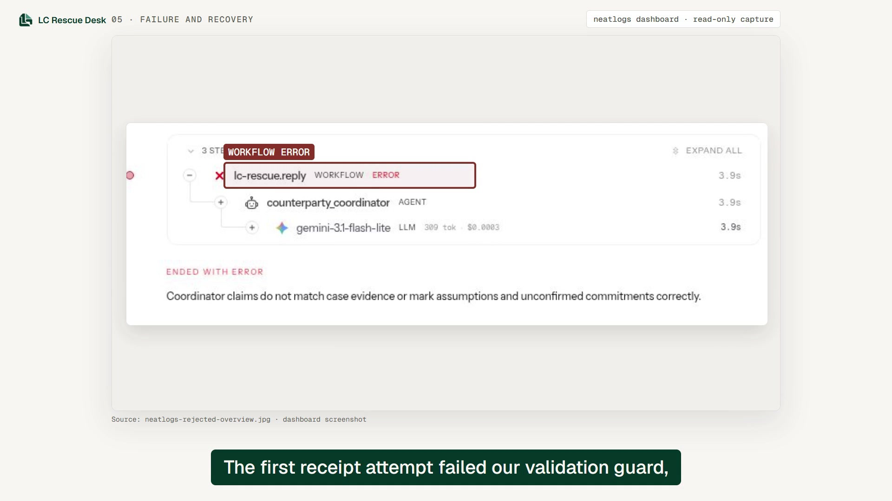
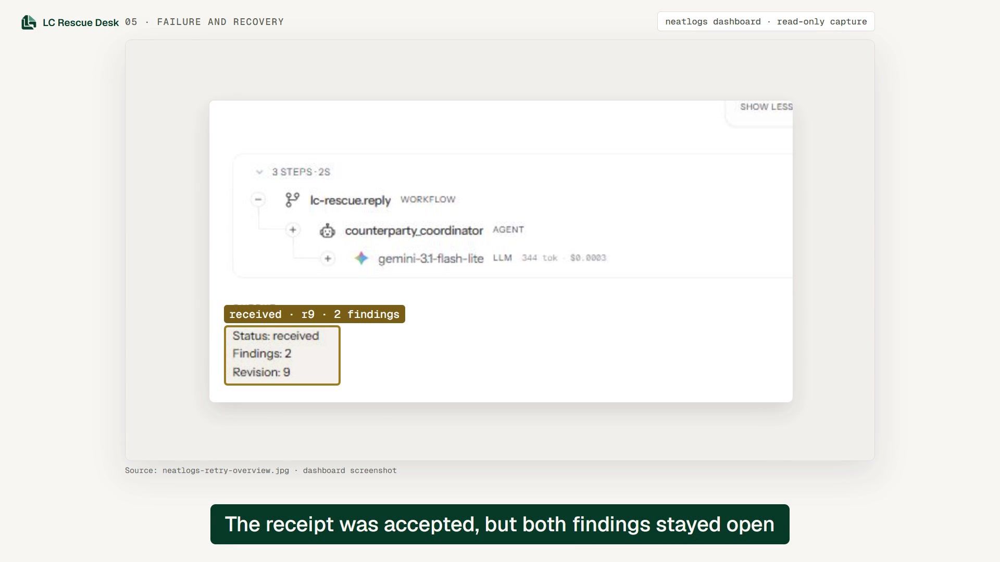
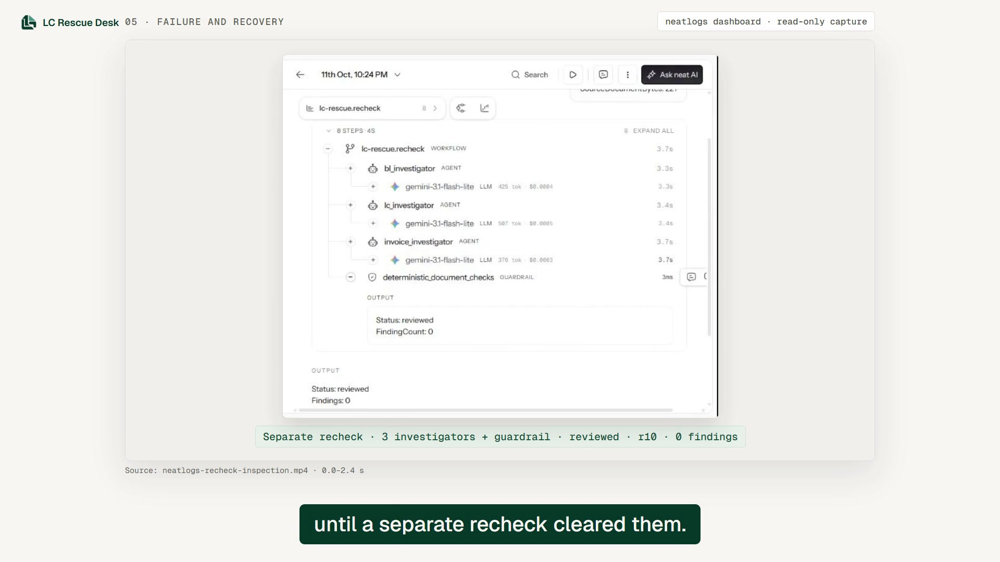
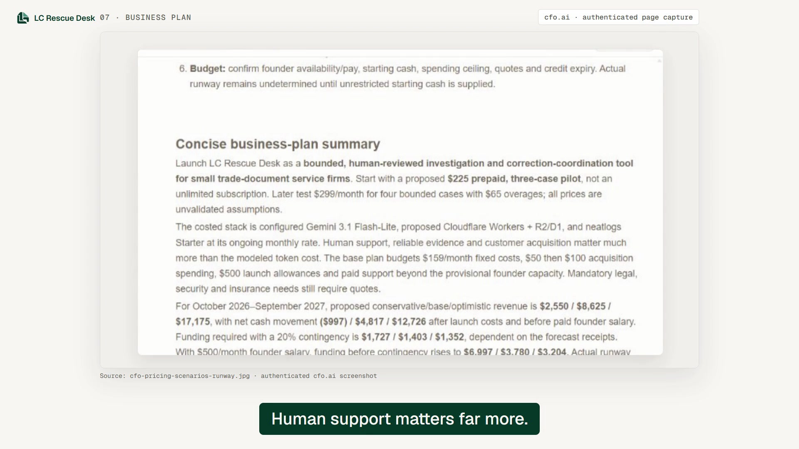

# LC Rescue Desk

**[Watch the final demo and submission quote-post](https://x.com/RahmatUlla51126/status/2109692189982826518) · 2:56.67 · #neatHack**

A letter of credit can change while its document corrections are still being coordinated. LC Rescue Desk helps an export team compare the LC, commercial invoice and bill of lading, select a revised analysis basis, rebuild the recovery plan against current timing, and obtain approval bound to the exact document versions. Previous evidence and decisions remain available.

Live mode runs three document investigators in parallel, followed by a remedy planner and counterparty coordinator when supported corrections permit it. Deterministic code controls validation, deadlines, approval and final state. The video distinguishes **fixture rehearsal with zero model calls** from a **saved live synthetic case**. It shows two covered conflicts retained on receipt and cleared only by a separate recheck.

## Submission evidence

| Required tool | How it was used | Accessible evidence |
| --- | --- | --- |
| neatlogs | Nested workflow, agent, model and guardrail traces; validation-failure review; rejected receipt, bounded retry and independent recheck | [Recovery measurements](#measured-failure-and-recovery), [public demo frames](docs/submission-evidence-20261012/README.md) and the [dated live report](docs/lc-updates-live-receipt-recheck.md) |
| Entire | Approved Codex CLI hooks capture development context and associate checkpoints with Git commits | [Public checkpoint viewer](https://entire.io/gh/Rahmat9009/lc-rescue-desk/commit/945e2387867dc6ea2ac80806ca257e26aa97a943), checkpoint `01M4KKQFCR2B3TVHMYEHVKPW5H`; the published scope is the README development-history edit |
| cfo.ai | Proposed pilot pricing, cost allowances, twelve-month scenarios and funding/runway sensitivity | [Business-plan summary](#cfoai-business-plan) and [the plan as shown in the demo](docs/submission-evidence-20261012/cfo-plan-demo-frame.jpg) |

The public images are labelled frames from the submitted demo, except the separately captured Incidents-list image. They show synthetic project evidence and remain viewable without a sponsor-account login. Full case snapshots and unreviewed Entire transcripts are excluded from this repository.

### Measured failure and recovery

The receipt coordinator's first response failed the application's strict validation. Its input supplied seven facts while the validator required twelve literal output fields. The fix supplied the complete input contract with explicit types; validation stayed strict. A single controlled retry succeeded.

| Metric | Before: rejected receipt | After: receipt retry | Separate recheck |
| --- | --- | --- | --- |
| Coordinator input facts | 7 | 12 | Not a coordinator operation |
| Required coordinator output fields | 12 | 12 | Not a coordinator operation |
| Model attempts | 1 | 1 | 3 investigators |
| Provider-reported input / output tokens | 164 / 145 | 207 / 137 | 588 / 720 |
| Total reported tokens | 309 | 344 | 1,308 |
| Saved result | r8 · waiting | r9 · received | r10 · reviewed |
| LC / invoice / B/L versions | 2 / 1 / 1 | 2 / 2 / 2 | 2 / 2 / 2 |
| Open covered findings | 2 | 2 | 0 |

This is **one observed recovery following a contract fix**, not an accuracy benchmark or a comparison with a single-agent baseline. The retry used more tokens; billed cost was unavailable. Receiving revised documents did not close the findings. Only the independent, source-grounded recheck did.

- Rejected receipt: `bff1cc3367d4144865e5b5fe81e5f204`.
- Successful retry: `10b1a0923ab8d56bf34722af6a65dbe4`.
- Separate recheck: `e3a9c94d573d38c1871c8d9392ccfe4e`.

Authenticated dashboard screenshots, exports and a recheck recording were obtained after the dated live report. They show the failed root, retry input fields and saved result, and recheck output. These establish the inspected dashboard content, not an exhaustive audit of every span or source binding. The compact trace omits the original rejected provider JSON, so its exact mismatched field cannot be reconstructed.

<details>
<summary>View public neatlogs evidence from the submitted demo</summary>

**Rejected workflow:** the coordinator failed strict validation.



**Receipt retry:** the saved result is received at revision 9; both findings remain open.



**Separate recheck:** three investigators and deterministic checks produce reviewed at revision 10 with zero covered findings.



</details>

**Incidents-feature limitation:** during the final authenticated review on 12 October, this project's Incidents → All → All time view showed “No incidents yet,” with a note that incidents appear after the first Issue snapshot is published. The demo therefore shows genuine workflow-error traces and recovery evidence; it does not claim an incident recommendation guided the earlier fix. [View the captured empty list](docs/submission-evidence-20261012/neatlogs-incidents-empty.jpg).

### cfo.ai business plan

**[Read the full corrected cfo.ai business plan (PDF)](docs/submission-evidence-20261012/cfo-business-plan-corrected.pdf)**

I used cfo.ai to plan a bounded, human-reviewed pilot for small trade-document service firms. The plan separates proposed commercial prices, published tariffs used in the model, unquoted allowances, unpaid founder effort and customer-supplied qualified review.

| Area | Plan snapshot |
| --- | --- |
| Pricing | Proposed $225 prepaid pilot for three cases; $75 per case. Later test $299/month for four bounded cases plus $65 overages. |
| Costs | $159/month planned fixed costs, $500 unquoted launch allowance, acquisition spending and support capacity. Gemini planning allowance is about $0.033 per bounded case; it is not observed billed cost. |
| Revenue | Twelve-month conservative/base/optimistic assumptions: 34 / 115 / 229 paid cases and $2,550 / $8,625 / $17,175 receipts. These are not validated sales forecasts. |
| Funding and runway | Base peak funding requirement: $1,168.75 before contingency, approximately $1,403 with a 20% cushion. Actual runway is undetermined because unrestricted starting cash is unknown. |

Customer review time is unmeasured, not zero. Company support excludes full bank examination. Unpaid-founder cash surplus is not full economic profitability. Hackathon credits are not treated as committed funding, and the allowances are not a complete production-launch budget.

The demonstrated prototype accepts readable English text documents. PDF extraction is a planned extension. Nine calls per full workflow and three per reply assessment are conservative **financial planning allowances**, not implemented agent counts. The earlier 3,501-token adaptive example aggregated five initial calls and two correspondence assessments of two calls each; the revised-LC live case shown in this video is a different run with its own usage in the dated report.



A neatHack prototype for investigating LC document conflicts, proposing issuer corrections, recording human approval, assessing pasted counterparty correspondence, responding to simulated reply scenarios, and checking revised document versions.

## Current working scope

- English UTF-8 text-native LC, invoice and bill of lading, up to 16,000 characters each.
- Source-grounded extraction, currency/reference/explicit consignee conflicts, numeric/date checks and calculated presentation deadline.
- Exporter correction and carrier reissue request drafts. Approval binds source versions.
- Revised versions and originals retained; independent recheck; complete JSON audit export.
- Carrier delay and buyer-waiver scenarios produce safe escalation.
- Pasted exporter or carrier replies are retained as user-provided, authenticity-unverified correspondence. Exact quotes support typed timing statements; code checks the recovery plan against the saved deadline, findings and document versions. Materially updated correction requests need fresh approval.
- Owner-scoped D1 persistence with compare-and-swap revision checks.
- Complete same-reference revised LC assessment: stage without changing the active basis, compare grounded terms/findings/deadlines, explicitly select or dismiss, and retain previous sources and decisions. Selection invalidates old approvals and requires fresh timing and approval before corrections resume. Changes outside automated coverage remain blocked for specialist review.

**Demo mode is deterministic fixture execution. It runs zero LLM agents and zero telemetry exports.** Live investigation executes three document investigators concurrently, then a remedy planner and counterparty coordinator when supported corrections permit it. Code, rather than the model, controls validation, approval and final state. A bounded synthetic revised-LC workflow through receipt and separate recheck has been verified locally; authenticated dashboard evidence now supports the three receipt/recheck traces shown above. Exhaustive span and binding readback remains incomplete. See [the verification report](docs/lc-updates-live-receipt-recheck.md).

No bank-ready certification is claimed. Full UCP/ISBP interpretation, bank holidays, original-document authenticity, PDFs/OCR, recipient verification, external messaging and bank submission are outside this build. Only explicit consignee terms are compared; general name variation is not implemented. Counterparty reply scenarios are simulated in both modes. Live revised documents are user uploads, not model-generated third-party instruments.

## Local development

Use Node 24 and pnpm. From this folder:

```sh
pnpm install
pnpm run build
pnpm exec wrangler d1 execute DB --local --config dist/server/wrangler.json --persist-to .wrangler/state --file drizzle/0000_steady_namorita.sql
pnpm run dev
```

Apply that schema only to a fresh local database. Production uses tracked schema migrations automatically. For repeated development, preserve the local database. The Vite dev server uses a local auth mock and serves the demo at `http://127.0.0.1:5173/`; the built Wrangler server started by `pnpm run start` requires Sites-authenticated identity and does not provide a local sign-in route.

For live local runs, keep an ignored root `.dev.vars` with the names in `.env.example`. The Vite dev server reads this root file. Every build copies it into `dist/server/.dev.vars` for the generated Wrangler config, and `pnpm run start` refreshes that copy before launch. Keep the root file and local `.wrangler/state` database; rebuilds do not require another schema import. Do not commit either secret file. For a hosted run, configure the same values as server runtime settings, not in client code.

```sh
pnpm run typecheck
node --test tests/domain.test.mjs
# Requires the built Worker from pnpm run build:
node --test tests/api.test.mjs
node --test tests/live.test.mjs
```

The in-process API tests run Miniflare with isolated test D1 databases and mocked external providers. Run the complete suite with `pnpm test` after building. Browser QA, including committed selection followed by drafting failure and its recovery path, is documented in [Phase 4 verification](docs/lc-updates-phase4-verification.md).

## Entire development history

Entire tracks this project through approved Codex CLI hooks. On this Windows machine, launch Codex with:

```sh
codex -c windows.sandbox=mxc
```

Imported checkpoints represent earlier sessions. New captured work can be linked to Git commits.

Local Entire capture remains enabled. Automatic checkpoint pushing is disabled through the ignored `.entire/settings.local.json` setting `strategy_options.push_sessions: false`. Normal publication pushes only `main` to `origin`. One reviewed checkpoint ref was explicitly published and is linked below; other checkpoint refs and transcript archives remain local. Verify the effective setting with `entire status` before pushing.

## Live model and neatlogs configuration

- `GEMINI_API_KEY`: server secret for Google's Gemini API.
- `LC_MODEL`: a Gemini model ID available to that key and supporting JSON output. The verified local choice is `gemini-3.1-flash-lite`; keep the selected value in `.dev.vars`.
- `NEATLOGS_WRITE_KEY`: server secret, **HTTP write key** starting `nlw_`.
- `NEATLOGS_PROJECT`: exact neatlogs project **name** (not its UUID).

The SDK project key is a different credential. This hosted Worker uses the documented HTTP integration because the Node SDK requires dynamic code generation unavailable in Workers.

Live document input and model outputs are sent to Gemini. The Worker uses raw `fetch` to Google's [OpenAI-compatible chat completions endpoint](https://ai.google.dev/gemini-api/docs/openai) with JSON-object output, minimal reasoning and an 8,192-token output budget. Start with synthetic or anonymized documents. Failed live actions retain the last valid business state and record the failure; supported correspondence extraction survives a rejected plan, and a drafting failure does not roll back committed LC selection. They do not fall back to fixtures. Provider-reported token usage is accumulated. No pricing or currency cost is invented; use the selected model's actual billing for cfo.ai.

A bounded synthetic case using `gemini-3.1-flash-lite` completed investigation, revised-LC staging and selection, current correspondence/planning, human approval through the UI, revised-document receipt and separate recheck. Provider usage, real rejected proposals and trace acknowledgments are documented in `docs/`; these do not establish model quality on private trade documents. The later submission evidence records authenticated dashboard readback of the inspected receipt/recheck content; a complete binding audit remains outstanding.

Tracing builds one complete nested WORKFLOW/AGENT/LLM/GUARDRAIL tree per invocation and posts it to `https://ingest.neatlogs.com/v1/trace` with `User-Agent: LCRescueDesk/0.1`. Every node ends before export; all concurrent workers are awaited even when one fails. Status, timing, model IDs, provider-reported tokens and validation outcomes remain in the trace. The service-generated trace ID and acknowledged span count are recorded only on a valid receipt. Tokens are absent when usage is unknown, rather than invented as zero.

The HTTP trace intentionally omits raw source documents, exact system prompts, duplicate AGENT input/output copies, repeated finding details in planner/coordinator inputs, and full coordinator draft text. Document kind, version and byte length identify the saved source. Revised-LC traces also omit raw provider output and quotations, retaining source versions/digests, assessment identifiers, outcomes and counts; exact bindings, extracts and full histories remain in the saved case. The complete span tree and actual provider usage are preserved. Observed transport successes and failures are measurements, not an official neatlogs size limit. Failure events record request bytes and node counts without changing the case result. Authenticated readback of the displayed receipt/recheck root outcomes, input facts and usage is documented above; complete span/source-binding readback remains unverified.

The Node SDK local Doctor initially passed, but the mocked live Worker test exposed an EvalError while importing it. The hosted application was changed to HTTP injection; the SDK diagnostic does not validate this hosted HTTP path.

### Required evidence loop

1. Configure the HTTP write key, exact project name and model settings securely.
2. Open a **live** case with synthetic source documents and run investigation.
3. Find the exact trace ID in the audit trail and read it back in the neatlogs dashboard.
4. Check a finalized root, three parallel investigator agents and their LLM children, deterministic guardrail, remedy planner and coordinator; inspect source/output and provider usage.
5. Exercise an invalid JSON or unsupported extraction branch; inspect the real failure trace, fix the cause, and rerun with a fresh correlation marker.
6. Inspect recheck and simulated-reply workflows separately. Record actual trace links in Evidence.

| Workflow | Trigger | Expected capture | Verification |
| --- | --- | --- | --- |
| Investigation | Investigate live case | Root; 3 investigators/LLMs; guardrail; planner/LLM; coordinator/LLM for supported conflicts | Synthetic execution verified; full persisted binding audit pending |
| Recheck | Upload revised documents, then recheck | New root; 3 investigators/LLMs; guardrail; correction roles only if new findings | Synthetic execution and displayed dashboard root/output inspected; full binding audit pending |
| Reply assessment | Simulated delay/waiver or uploaded revision receipt in live case | Root; coordinator/LLM | Rejected receipt and successful retry inspected in the dashboard; full binding audit pending |
| Fixture rehearsal | Demo actions | No neatlogs export or LLM calls | API and domain tests |

An export request, a local Doctor pass, or a trace ID alone is not evidence that the application's trace was persisted correctly.

## Sponsor integration status

- neatlogs is configured and used through its documented HTTP integration. Authenticated receipt/recheck dashboard evidence and its remaining boundaries are recorded above. [Setup guide](https://neatlogs.com/hackathon/neatlogs-setup-guide.html).
- Entire CLI capture is configured, commits carry checkpoint trailers, and one reviewed checkpoint is publicly linked. Automatic bulk checkpoint pushing remains disabled.
- cfo.ai was used for the pilot business plan shown in the submitted demo. The financial assumptions are summarized above.
- The Incidents view is empty at final review; the screenshot records this feature-specific limitation. [Organiser support](https://neatlogs.com/discord).

## Demo rehearsal

1. New case → Synthetic demo → Investigate.
2. Show EUR vs USD and explicit B/L consignee conflict, each with source quotes.
3. Review drafts → Approve correction requests.
4. Receive synthetic revised versions → Recheck. Show retained originals in Documents.
5. Open a second case and choose Carrier delay. Show that the deadline prevents a resolved outcome.
6. Export case evidence, then show the sponsor artifacts linked in Submission evidence.

For the adaptive plan rehearsal, open a new synthetic case and investigate. Its case date is 2026-10-10 and calculated deadline is 2026-10-12. In **Correspondence and recovery plan**, submit the exporter reply `We will send the corrected invoice tomorrow.` Then submit the carrier reply `We can reissue the B/L in four days.` The second assessment should show a 2026-10-14 carrier date, a deadline conflict, human escalation and clarification, exact supporting quotes, unresolved questions, and the previous plans. Demo mode uses zero model calls. The pasted replies are user-provided and their authenticity is unverified; no bank extension, waiver, issuer confirmation or successful presentation is inferred.

To check explicit dates, use `We will send the corrected invoice on 2026-10-12.` from the exporter and `We can reissue the corrected B/L on 2026-10-16.` from the carrier. The complete quotes and dates should appear, with the October 16 carrier date after the October 12 deadline. Availability of the invoice on the deadline leaves presentation time unresolved. For a previously saved case whose extracted quotes lost their dates, select **Reassess saved correspondence**; this rechecks the original pasted text deterministically, retains the earlier assessment and plan, and makes no model calls.

Do not pitch fixture execution as actual multi-agent execution. No benchmark against a competent single-agent baseline has yet been run. Record fairness, latency, token cost, discrepancy precision and correction outcome when building that comparison.

## Verified build checkpoint

2026-10-12: strict TypeScript check, production build, and all **94 tests** passed (`pnpm test` after `pnpm run build`). Every automated test runs offline against mocked model and neatlogs ingest endpoints and isolated in-memory D1 databases. The tests verify application logic and contracts. They do not prove real model quality or live provider behaviour; the only live evidence is the bounded synthetic run described above and in `docs/`. The live happy-path test and the saved-deadline boundary tests run on dedicated test Workers with a fixed instant supplied through the `LC_TEST_FIXED_NOW` binding, which only the test harness sets; deployed Workers always use the real clock. The pre-existing `app/desk.tsx` set-state-in-effect lint error remains, alongside 15 warnings. No deployment is implied by these checks.

The frontend includes version-bound assessment controls, source comparisons, correction-request review, responsive navigation, a landing entrance, and a continuously moving thread background on the landing (adapted from React Bits Threads; pause control, live reduced-motion handling and a static WebGL fallback; see [`design/threads-background.md`](design/threads-background.md)). The case-opening modal shows submission and upload errors beside the controls that caused them, prevents duplicate submissions, and its upload controls are keyboard operable. Design research and HTML studies are preserved in `design/`; downloaded reference screenshots and local browser renders are excluded from public Git. Runtime output, local case exports and databases are also excluded.

### Published checkpoint evidence

- Checkpoint ID: `01M4KKQFCR2B3TVHMYEHVKPW5H`
- [View the checkpoint and linked commit](https://entire.io/gh/Rahmat9009/lc-rescue-desk/commit/945e2387867dc6ea2ac80806ca257e26aa97a943)

This checkpoint captures the README development-history edit.
Automatic bulk checkpoint pushing remains disabled.

## Building in public

Follow our #neatHack development updates:

- [X — final submission with the demo](https://x.com/RahmatUlla51126/status/2109692189982826518)
- [X — synthetic workflow and required tools](https://x.com/RahmatUlla51126/status/2109383439585820748?s=20)
- [LinkedIn — revised-LC workflow and failure recovery](https://lnkd.in/p/dfiq8M6t)
